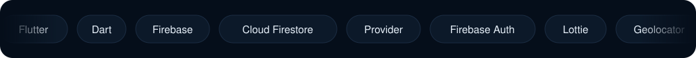
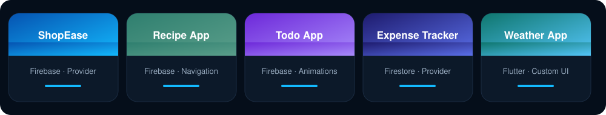

### 👋 About me
- 📱 Flutter and Dart developer who builds complete apps with **Firebase**, **Provider** and clean architecture
- 🎓 Bachelor of Software Engineering student at Nazeer Hussain University
- 🏅 IBM certified: *Flutter and Dart: Developing iOS, Android, and Mobile Apps* (Coursera)
- 💼 Flutter intern at Codomax Digital Solutions, previously freelance WordPress developer (11+ websites)
- 🚀 Currently looking for a Flutter developer role

### 🛠️ Tech I use

### 📲 Featured projects

| App | What it does | Code |
|---|---|---|
| **ShopEase** | Full e-commerce app: auth, Firestore products, cart, checkout, location | [View](https://github.com/akhtarzia588/Shop-Ease) |
| **Recipe App** | Browse, search and save recipes, meal plan, add your own | [View](https://github.com/akhtarzia588/Recipe_app) |
| **Todo App** | Dark and gold task manager with swipe to delete and undo | [View](https://github.com/akhtarzia588/Todo_app) |
| **Expense Tracker** | Live expense total with Provider and Firestore | [View](https://github.com/akhtarzia588/Expense-Track) |
| **Weather App** | Glass-style weather UI with humidity, wind, sunrise and sunset | [View](https://github.com/akhtarzia588/Weather-app) |

### 📊 GitHub stats

